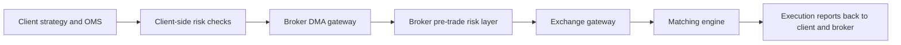

This page explains direct market access (DMA): what it is, how an order travels through a DMA setup, which controls sit on the path, and how the main regimes regulate it. It then shows where DMA matters for a Delta-1, ETF market making and arbitrage desk.

<Info>
  **Status of this page.** Last checked on 17 November 2026. The definitions and the US and EU rules follow the regulator and industry sources listed under Sources. The Hong Kong section follows the structure of the SFC Code of Conduct and HKEX materials, and the clause-level details are listed under [Points to verify](#points-to-verify-before-relying-on-this-page). This is a framework for understanding, not legal advice and not any firm's access policy.
</Info>

## What DMA is

Direct market access lets a client send orders electronically to an exchange or other trading venue under a broker's market participant identity, without the broker's staff handling each order. The client keeps control of the order decisions, and the broker stays responsible to the venue and the regulator for what is sent under its name.

MiFID II calls the wider concept direct electronic access (DEA). It covers two arrangements: DMA, where the client uses the member's trading infrastructure to transmit orders, and sponsored access, where the client sends orders under the member's code without going through the member's infrastructure.

| Model | Who provides the infrastructure | Where broker risk controls sit | Typical user |
| --- | --- | --- | --- |
| Care or high-touch order | Broker trader handles the order | Broker systems and the trader | Clients who want judgement and discretion on execution |
| Broker algorithm or smart order router (SOR) | Broker | Broker systems, before the venue | Clients who want execution help with automated logic |
| **DMA** | Broker's gateway and risk layer, client's own order system | Broker's risk layer, in the path of every order | Proprietary desks, funds and market makers that run their own execution logic |
| **Sponsored access** | Client connects to the venue directly under the broker's code | Must still be enforced for the broker, for example at the venue gateway | Latency-sensitive firms |
| Unfiltered ("naked") access | Client connects directly with no broker pre-trade filter | None | Effectively prohibited in the US by Rule 15c3-5. In the EU, DEA without the required controls is prohibited. |

## The order path

The client's own checks are the first line of defence. The broker's risk layer is the one the regulator holds the broker accountable for, so it must not depend on the client behaving correctly. Market data usually travels on a separate path. For example, HKEX's securities order gateway carries orders only, and market data comes from a separate market data platform.

## Pre-trade risk controls

A broker providing DMA applies automated checks before an order reaches the venue. The set below follows the common content of the US and EU rules and of industry practice.

| Control | What it prevents |
| --- | --- |
| Maximum order size and notional | Fat-finger errors and runaway orders |
| Price collar against a reference price | Orders far from the market, including a market order into a thin book |
| Credit, capital and position limits | Exposure beyond what the broker will finance or carry |
| Order and message rate limits | Loops and message storms |
| Duplicate order detection | Repeated sends after a timeout or a bug |
| Restricted lists and regulatory flags | Trading in prohibited instruments, or missing short sale marks |
| Kill switch and cancel on disconnect | Stopping a client quickly, and removing resting orders when a session drops |

Two design points matter in practice. First, the controls must be applied before the order leaves, not reviewed afterwards. Second, they must be enforced on the broker side, and the client should not be able to switch them off. The same pre-trade ideas appear in the system design question on [pre-trade risk checks](/quantitative-dev/mock/system-design).

## How the main regimes treat DMA

<Tabs>
  <Tab title="United States">
    SEC Rule 15c3-5, the Market Access Rule, was adopted in November 2010 and applies to broker-dealers that have market access or give it to customers. It requires risk controls and supervisory procedures that work automatically before an order is sent. The controls must cover financial risk, such as credit and capital limits, and regulatory risk, such as compliance with exchange and SEC trading rules.

    With limited exceptions, the controls must be under the direct and exclusive control of the broker-dealer that provides access. This is why "naked" sponsored access, where the customer sends orders with no broker pre-trade filter, is effectively prohibited. The rule also requires regular review of the controls and an annual certification by the firm.
  </Tab>
  <Tab title="European Union and UK">
    Under MiFID II Article 17(5) and Commission Delegated Regulation (EU) 2017/589 (RTS 6), an investment firm that provides DEA must have systems and controls to prevent clients from breaching the firm's risk limits or the venue's rules. RTS 6 Articles 19 to 23 set out the detail, including due diligence on prospective DEA clients, and sponsored access must be controlled as strictly as DMA.

    ESMA's Q&A says the DEA provider's obligations apply whether or not the client is itself an authorised EU investment firm. The provider remains responsible for orders sent through the service, including where the client sub-delegates access to its own clients. In the UK, the FCA Handbook (MAR 7A.4) carries the equivalent rules, and a firm must notify the FCA that it provides DEA.
  </Tab>
  <Tab title="Hong Kong">
    The SFC Code of Conduct for Persons Licensed by or Registered with the SFC covers electronic trading in paragraph 18 and Schedule 7. The table of contents of the current edition lists paragraph 18.7 on risk management for internet trading and DMA, and paragraph 18.8 on minimum client requirements for DMA, next to the algorithmic trading paragraphs. The SFC's electronic trading rules took effect on 1 January 2014, and licensed firms must have policies, procedures and controls so that their electronic trading does not pose undue risk to the market.

    A DMA provider in Hong Kong therefore does two things: it controls the orders its clients send, and it assesses whether a client is suitable to receive DMA. Broker materials on the rules note that a client who passes its DMA access on to its own clients (sub-delegation) needs a good understanding of those clients and the systems and algorithms they use.
  </Tab>
</Tabs>

<Warning>
  The three regimes share the same principle, which is that the firm whose name or code is on the order is accountable for it. They differ in wording, scope and detail. Use the primary text of the rule that applies to your firm and venue, not this summary.
</Warning>

## Hong Kong connectivity: OCG-C and throttles

An Exchange Participant (EP) of the Stock Exchange of Hong Kong connects its broker supplied system (BSS) to the HKEX trading platform through one or more Orion Central Gateway sessions (OCG-C). HKEX launched OCG-C on 27 September 2021 as the access point for the securities market. DMA clients of an EP reach the exchange through the EP's sessions, so the EP's gateway capacity and risk layer apply to them.

- **Throttle.** The throughput rate of messages into the trading platform through OCG-C is governed by a throttle. EPs can buy additional throttle from HKEX. Inbound messages include order submission, quotes and trade reports, and messages above the entitled limit in a throttle window are rejected.
- **Clock alignment.** HKEX's FAQ notes that OCG-C synchronises its clock with GPS, and that rejections are still possible when the throttle windows in a participant's system and in OCG-C are misaligned.
- **Orders only.** OCG-C is used for trading and does not disseminate market data or market status. Market data comes from the separate market data platform or through vendors.

For a DMA client, the practical effect is that the broker's session throttle is a shared resource. Several clients on the same session compete for it, and the broker's own rate limits sit on top of the exchange limit.

## Where DMA fits on a Delta-1 and ETF desk

| Use case | Why DMA is relevant |
| --- | --- |
| Hedging legs in markets where the firm is not an exchange member | The desk reaches the venue through a clearing or execution broker and keeps its own execution logic |
| Basket legs in ETF creation, redemption and arbitrage trades | Many orders must go out in a short time, which makes latency, message rate and throttle limits matter. See [ETF creation, redemption and arbitrage (Hong Kong)](/equities-derivatives/hk/cash-etf/creation-redemption). |
| Delta hedges for warrant and CBBC issuance | The hedge must follow the delta quickly, and a loop or a wrong-side order is expensive. See [Delta-1: hedging with listed derivatives](/equities-derivatives/global/delta-1-hedging). |
| Index basis and futures arbitrage | Two or more legs must be sent to different venues or products at nearly the same time. See [Index arbitrage and combined Delta-1 trades](/equities-derivatives/global/index-arbitrage). |
| Market making quotes | A market maker that is itself an EP uses its own gateway. A firm quoting through a broker is subject to the broker's rate limits and risk checks. See [ETF market maker rules](/equities-derivatives/hk/cash-etf/market-maker-rules). |

The trade-off for the client is control and speed against responsibility. With DMA the desk chooses the algorithm, the timing and the routing, and it accepts that its own errors will reach the market faster, limited only by the controls of the client and the broker.

## Operational risks to know

- **Fat-finger and market order incidents.** In 2018 the SFC reprimanded and fined Interactive Brokers Hong Kong HK$4.5 million over two incidents in which the share prices of two Hong Kong-listed companies roughly doubled within minutes. The cases involved client market orders executed through electronic and algorithmic systems. The point for DMA users is that a market order into a thin book needs a price collar.
- **Duplicate and orphan orders.** A timeout followed by a blind resend can create duplicates. The order state machine and unique client order IDs described in the [system design questions](/quantitative-dev/mock/system-design) address this.
- **Session loss.** Decide in advance whether resting orders are cancelled when the session drops, and test it.
- **Shared capacity.** Throttle and risk limits are shared with other clients of the same broker.
- **Responsibility gaps.** Sub-delegation and sponsored arrangements can hide who is actually sending the order. The provider must be able to identify it.

## Points to verify before relying on this page

1. **SFC Code of Conduct clauses.** This page relies on the paragraph headings of paragraph 18 and Schedule 7. Read the current text of 18.7, 18.8 and Schedule 7 for the exact client requirements, sub-delegation conditions and record keeping.
2. **Hong Kong order attributes.** Check the current HKEX requirements for client identification and short sell marking on orders sent through an EP's gateway.
3. **Broker-specific limits.** Order rate limits, price collars and kill switch behaviour are set by each broker and are not in any rule text. Ask your broker for its DMA risk control summary.
4. **EU and UK detail.** The RTS 6 article numbers are given for orientation. Confirm the current consolidated text and any UK changes after 2021.
5. **Other markets.** Mainland China, Japan, Korea, Taiwan and other Asian markets have their own access rules, and some restrict DMA by foreign clients. They are not covered here.
6. **Throttle numbers.** HKEX throttle sizes and fees change, so check the current HKEX schedule.

## Related pages

- [Delta-1: hedging with listed derivatives](/equities-derivatives/global/delta-1-hedging)
- [ETF creation, redemption and arbitrage (Hong Kong)](/equities-derivatives/hk/cash-etf/creation-redemption)
- [ETF market maker rules (Hong Kong)](/equities-derivatives/hk/cash-etf/market-maker-rules)
- [DMA and electronic execution mock interview](/equities-derivatives/mock/dma-electronic-execution)
- [Low-latency and high-frequency trading](/quantitative-research/microstructure/low-latency-hft)
- [Low-latency infrastructure](/quantitative-research/data-infra/low-latency-infrastructure)
- [System design mock interview (quant developer)](/quantitative-dev/mock/system-design)

## Sources

- [Market Access](https://www.finra.org/industry/market-access), FINRA
- [Risk Management Controls for Brokers or Dealers with Market Access, final rule](https://www.sec.gov/rules/final/2010/34-63241.pdf), SEC
- [SEC approves rule banning naked access to trading centers](https://www.morganlewis.com/pubs/sec-approves-rule-banning-naked-access-to-trading-centers), Morgan Lewis
- [ESMA Q&A on MiFID II and MiFIR market structures: direct electronic access](https://www.esma.europa.eu/publications-data/questions-answers/1618), ESMA
- [MAR 7A.4 Requirements when providing direct electronic access](https://handbook.fca.org.uk/handbook/MAR/7A/4.html), FCA Handbook
- [FIA due diligence template for prospective DEA clients](https://www.fia.org/sites/default/files/2019-05/FIA-DEA-DDQ-Template---No-Annexes-FINAL.pdf), FIA
- [Code of Conduct for Persons Licensed by or Registered with the SFC](https://sfc.hk/en/Rules-and-standards/Codes-and-guidelines/Codes/Code-of-Conduct-for-Persons-Licensed), SFC
- [Hong Kong electronic trading rules: sub-delegation of direct market access](https://www.jpmorgan.com/directdoc/hk_subdelegation.pdf), J.P. Morgan
- [SFC publishes consultation conclusions on electronic trading rules](https://www.thetradenews.com/?p=45049), The TRADE
- [SFC fines IBHK concerning electronic and algorithmic trading systems](https://dev2.charltonslaw.com/legal/newsletters/397/sfc-fines-ibhk-concerning-electronic-and-algorithmic-trading-systems.pdf), Charltons
- [Orion Central Gateway, Securities Market (OCG-C)](https://www.hkex.com.hk/eng/market/sec_tradinfra/ocg/orioncg.htm), HKEX
- [OCG-C FAQ: throttle](https://www.hkex.com.hk/Global/Exchange/FAQ/Securities-Market/Trading/Orion-Central-Gateway-Securities-Market-(OCGC)?sc_lang=en), HKEX
- [HKEX launches Orion Central Gateway, Securities Market](https://www.hkex.com.hk/News/Market-Communications/2021/210927news), HKEX
